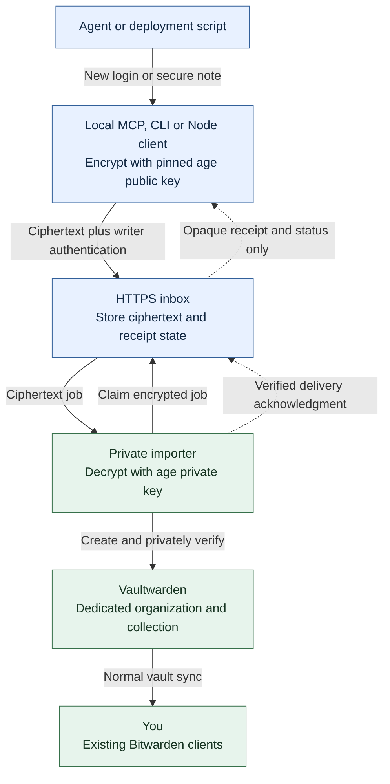
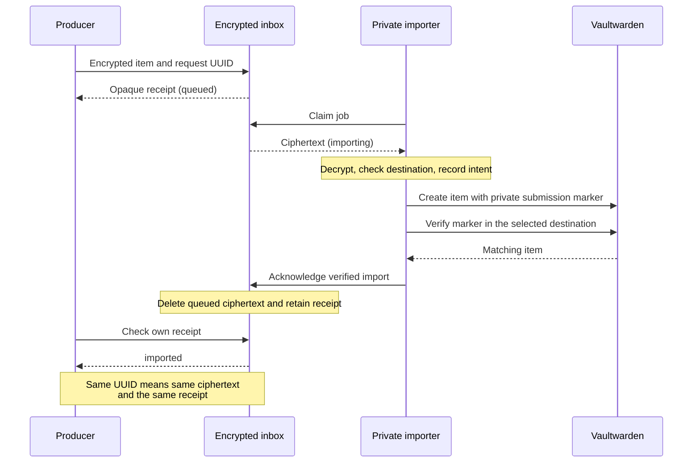

# vaultwarden-drop-slot-mcp

**MCP server, CLI and Node.js module for write-only credential deposits into a
self-hosted Vaultwarden (Bitwarden-compatible) vault.** AI agents such as Claude
Code and Codex, and deployment scripts, can save new logins (passwords) and secure
notes, encrypted with age before they reach the inbox, without a vault login that
can read existing secrets.

[](https://github.com/ip2k/vaultwarden-drop-slot-mcp/actions/workflows/verify.yml)

## TL;DR

**Let an agent save a new password without giving it the keys to your vault.**

An agent or deployment script creates a credential. You want it saved in
Vaultwarden without pasting it into chat, copying it by hand, or giving that
agent a vault login that can read existing passwords. This project provides a
**deposit-only path**: encrypt the new item, hand it to an inbox, and receive a
receipt. A separate trusted importer saves it as an ordinary login or secure
note that you open with your existing Bitwarden clients.

- **For agents:** two MCP tools — deposit a secret and check its delivery status.
- **For scripts:** a stdin-based CLI and a typed Node.js module.
- **For operators:** portable Docker containers, your own Vaultwarden, and a
  dedicated importer account. No changes to Vaultwarden are required.

**The restriction applies to the producer.** The importer has vault access;
keep its account and host private. Secrets included in AI tool arguments can
still be seen by the AI provider. Use the CLI or Node module directly when a
script can generate and deposit a secret without involving the model.

**Release 0.1.0.** Install from npm (`npm install vaultwarden-drop-slot-mcp`,
or run `npx -y vaultwarden-drop-slot-mcp`), from this repository, or from a
locally packed tarball. The MCP server is also listed in the
[MCP Registry](https://registry.modelcontextprotocol.io) as
`io.github.ip2k/vaultwarden-drop-slot-mcp`. Containers are built locally. Original code is Apache-2.0. This is an independent project,
not affiliated with Bitwarden or Vaultwarden. See the
[verification record](docs/VERIFICATION.md) for tested behavior and limits.

**Start here:** [Setup walkthrough](docs/SETUP.md) ·
[MCP connections](docs/MCP-CONNECTIONS.md) · [Operations](docs/OPERATIONS.md) ·
[Security design](docs/THREAT-MODEL.md)

## From a new credential to your vault



The inbox cannot decrypt the payload. Only the private importer holds the age
identity and the dedicated Bitwarden CLI session. The public API has no vault
read, search, list, edit, or delete operations. Item URLs are stored as text;
the service never fetches them.

## How it fits together

| Component | Has | Can do |
| --- | --- | --- |
| Local MCP / CLI / Node client | Writer token, pinned public recipient | Encrypt, deposit, check own receipts |
| HTTPS inbox | Token hashes, encrypted queue | Authenticate, queue, return delivery states |
| Private importer | age private key, dedicated vault session | Decrypt and create; privately read to verify delivery |
| Optional remote MCP adapter | OAuth configuration, writer credentials | Authenticate users, encrypt plaintext tool arguments, forward deposits |

The **writer capability is create-only**. The importer is trusted and can read
everything its account can access. Use a dedicated automation account and a
separate organization shared with your normal account. A folder or collection is
not an independent cryptographic boundary. Personal-vault mode requires an
explicit configuration opt-in.

An HTTP MCP adapter sees plaintext, as does an AI provider receiving those tool
arguments. For secrets generated by a deployment script, pipe directly into the
local CLI or call the Node module. No arbitrary file-path, URL-fetch, shell, read,
search, edit, or delete tools exist.

## Setup overview

Follow the [complete setup walkthrough](docs/SETUP.md) for copyable commands,
file permissions, TLS, owner login, routing and a first test. It assumes a
Linux Docker host with Compose v2 and an existing HTTPS Vaultwarden instance;
the local client/module needs Node.js **24.2+**. Image builds support amd64 and
arm64; execution has been verified on amd64.

1. **Build from source.** Clone this repository, run `npm ci --ignore-scripts`,
   `npm test`, and `npm run build`. Build the default runtime and optional importer
   images. The default image contains no Bitwarden CLI.
2. **Create a private deployment directory.** Generate enrollment material and
   split producer, inbox and importer files. Keep it outside the checkout.
3. **Configure TLS and start the inbox.** Use certificates trusted by the clients
   and importer. Publish only the HTTPS intake port; the worker port stays private.
4. **Enroll a dedicated vault account.** Create an organization and collection,
   invite the importer as a User, accept and confirm membership, and explicitly
   grant collection edit access. Log in from your private terminal.
5. **Set the destination and start the importer.** Map the writer ID to the
   organization and collection UUIDs in private configuration.
6. **Test, then connect MCP.** Deposit a synthetic item, wait for `imported`, and
   open it in your normal Bitwarden client. Then follow the
   [client-specific MCP instructions](docs/MCP-CONNECTIONS.md).

```sh
git clone https://github.com/ip2k/vaultwarden-drop-slot-mcp.git
cd vaultwarden-drop-slot-mcp
npm ci --ignore-scripts
npm test
npm run build
node dist/cli.js --help
```

For a Node application, `npm install vaultwarden-drop-slot-mcp`. To use a
local build instead, run `npm pack` here and install the resulting `.tgz` with
`npm install /absolute/path/vaultwarden-drop-slot-mcp-0.1.0.tgz`.

## What a receipt means



`queued` means accepted by the inbox; `imported` means privately verified in the
vault. A locked importer leaves work queued. Failures and ambiguous creates use
bounded retries and private reconciliation; see [delivery limits](#delivery-and-operational-limits).

## Local MCP

After completing setup, configure your MCP client to launch the executable with
a private producer config file. Use absolute paths; the paths below are examples.
See [MCP connections](docs/MCP-CONNECTIONS.md) for Claude Code, Codex, desktop
clients, Docker stdio and remote HTTP instructions:

```json
{
  "mcpServers": {
    "vaultwarden-drop-slot": {
      "command": "node",
      "args": ["/absolute/path/to/dist/cli.js", "stdio", "/private/path/client.json"]
    }
  }
}
```

Exactly two tools are available:

- `deposit_secret({request_id, payload})`: queue a new login or secure note.
- `deposit_status({receipt})`: return `queued`, `importing`, `imported`, or `failed`.

Use a fresh UUID for each new item. Reuse it only to retry the **original** item.
The client retains the original encrypted envelope in its private spool; changed
arguments with the same request ID do not create or overwrite anything. Retrying
after a timeout therefore uses exactly the same ciphertext. Keep the spool until
retries are no longer needed; it is bounded at 10,000 entries.

Tools return receipts only. Keep tokens in host configuration; never put them in
prompts, tool arguments, or checked-in MCP settings.

## CLI and Node module

The `deposit` command reads `{request_id,payload}` JSON from stdin. A secret
generator can pipe to it without putting the secret in shell arguments or a file:

```sh
your-secret-generator | node dist/cli.js deposit /private/path/client.json
node dist/cli.js status /private/path/client.json RECEIPT_UUID
```

The npm module exports a typed `DepositClient`, `seal`, `fingerprint`, validation
schemas, and protocol types. Example inside your own deployment program:

```ts
import { DepositClient } from 'vaultwarden-drop-slot-mcp';

const client = new DepositClient(enrolledClientConfig);
const receipt = await client.deposit(persistedRequestId, {
  type: 'login',
  name: 'New service',
  username: generatedUsername,
  password: generatedPassword,
  urls: ['https://service.example.com'],
});
// Only the receipt is safe to log.
console.log(receipt);
```

`prepare()` writes a ciphertext-only spool entry; `submit()` sends that exact
envelope. These are available separately for applications with their own retry
logic. URLs in payloads are stored as data and are never fetched.

## Remote MCP

`mcp-http remote.json` serves stateless Streamable HTTP at `/mcp` over native
HTTPS. It requires an existing OAuth authorization server, audience-bound JWT
access tokens, expiry, `client_id` and `sub` claims, and both `deposits:write` and
`deposits:status` scopes. Configure issuer, JWKS URL, algorithm and approved
subject/client mappings; discovery is exposed at
`/.well-known/oauth-protected-resource/mcp`. No authorization server is built here.

See [remote setup](docs/REMOTE-MCP.md). Hosted assistants also need a reachable
HTTPS endpoint and an OAuth provider/client-registration configuration they
support. End-to-end hosted Claude/ChatGPT enrollment remains a separate check.

## Delivery and operational limits

The queue and importer ledger use transactional SQLite in WAL mode with full
synchronization. One logical importer/ledger per installation is supported.
Idempotency is namespaced by writer and request UUID. Delivery is marked imported
only after private verification in the vault.

There is no cross-system atomic transaction with Vaultwarden. A durable creation
intent permits **at most one automatic create attempt**; ambiguous results are
reconciled by a private encrypted marker. If the process dies between recording
intent and sending the create, operator recovery is required. This deliberately
prefers a visible failed/queued submission to silent duplicate creation. Do not
claim universal exactly-once delivery.

Defaults: 100 new deposits per writer per UTC day, 100 pending per writer,
100,000 receipt tombstones per installation, five bounded delivery attempts,
seven-day undelivered-ciphertext retention, and immediate ciphertext deletion
after verified import. Locked vaults stay queued without consuming the retry
budget, until retention expires. Token expiry/revocation takes effect on the
next request. Successful receipts remain as compact idempotency tombstones.

Read the [threat model](docs/THREAT-MODEL.md), [operations guide](docs/OPERATIONS.md),
[OpenAPI contract](docs/openapi.json), and [dependency inventory](docs/DEPENDENCIES.md).
